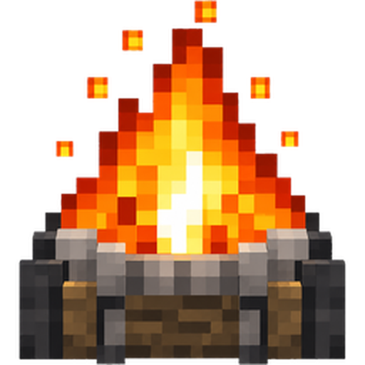

<div align="center">



# Wayfire

**Быстрый и красивый лаунчер для Minecraft: Java Edition**

Любые версии и снапшоты · Forge, NeoForge, Fabric, Quilt · моды Modrinth · игра с друзьями

[**Сайт и скачивание**](https://wayfire.ds9418048.workers.dev/) · [Возможности](#возможности) · [Сборка из исходников](#сборка-из-исходников)

</div>

---

## О проекте

Wayfire запускает Minecraft без лишних шагов: впишите ник, выберите сборку и нажмите «Играть». Лаунчер сам скачает игру, библиотеки, ресурсы и нужную Java. Он бесплатный, без рекламы и без входа в аккаунт.

Приложение написано на Electron и JavaScript. Интерфейс в пиксельном стиле, настройки и сборки хранятся на вашем компьютере.

## Возможности

- **Запуск в один клик.** Игра, библиотеки и ресурсы скачиваются и проверяются автоматически. Повторные запуски быстрые: уже скачанные файлы не перепроверяются.
- **Java подбирается сама.** Если на компьютере нет подходящей Java, лаунчер скачивает ту, которая нужна выбранной версии игры, с серверов Mojang.
- **Все версии.** Полный список версий Minecraft, включая снапшоты (галочка «Показывать снапшоты и старые версии»).
- **Загрузчики.** Ваниль, Fabric, Quilt, Forge и NeoForge. Для каждого можно выбрать любую доступную версию загрузчика.
- **Сборки.** Сколько угодно сборок, у каждой своя папка с модами и мирами. Ненужную сборку можно удалить в один клик.
- **Моды.** Каталог Modrinth прямо в лаунчере.
- **Скин.** Загруженный PNG-скин подставляется в игру через автоматический ресурспак.
- **Игра с друзьями.** Соединение напрямую по кодам приглашения, без отдельного сервера (подробнее ниже).
- **Закрытие после запуска.** Лаунчер может сам закрываться, когда игра стартовала (настраивается).

## Важно про аккаунт и лицензию

Wayfire работает в **офлайн-режиме**: вы вводите только ник (латинские буквы, цифры и `_`, от 3 до 16 символов), входить в аккаунт Microsoft не нужно. По умолчанию это ник `Steve`.

Что это значит на практике:

- Подходит для одиночной игры, игры по локальной сети и серверов, где отключена проверка лицензии.
- На серверы с проверкой лицензии (`online-mode=true`) такой аккаунт не пустят. Это решает сервер, а не лаунчер.
- Скин, который вы загружаете в Wayfire, виден только вам. Другие игроки на сервере увидят стандартный скин.

Если Minecraft вам нравится, поддержите разработчиков и купите игру на [minecraft.net](https://www.minecraft.net/).

## Скачать

Установщик для Windows 10 и новее лежит на сайте: **https://wayfire.ds9418048.workers.dev/**

Установщик пока не подписан платным сертификатом разработчика, поэтому при первом запуске Windows может показать окно SmartScreen. Нажмите «Подробнее», затем «Выполнить в любом случае».

Версии для macOS и Linux пока не выпущены, но их можно собрать самостоятельно (см. ниже).

## Сборка из исходников

Нужен [Node.js](https://nodejs.org/) (версия LTS).

### Запуск без установки

```bash
git clone https://github.com/ds9418048-hash/wayfire-launcher
cd wayfire
```

- **Windows:** дважды щёлкните `start.bat`.
- **macOS и Linux:** выполните `./start.sh`.

Первый запуск скачивает Electron, это занимает пару минут.

### Установщик для Windows

Дважды щёлкните `make-installer.bat`. Через несколько минут откроется папка `dist` с файлом `Wayfire-1.0.0-win.exe`.

Если появится ошибка про `symbolic link`, запустите файл от имени администратора.

### Установщики для Windows, macOS и Linux через GitHub Actions

Установщик для macOS можно собрать только на Mac, поэтому в репозитории есть готовая автоматическая сборка:

1. Откройте вкладку **Actions** в вашем репозитории.
2. Выберите **Build Wayfire** и нажмите **Run workflow**.
3. Через 5–10 минут откройте завершённый запуск. В разделе **Artifacts** будут установщики для всех трёх систем.

Файл сборки: [`.github/workflows/build.yml`](.github/workflows/build.yml).

## Игра с друзьями

Игра идёт напрямую между игроками, отдельный сервер не нужен. Нужно только обменяться кодами в любом чате.

1. **Хозяин:** вкладка «Игра с друзьями» → «Я хозяин: создать код». В Minecraft откройте мир, нажмите Esc и «Открыть для сети». Отправьте код другу.
2. **Друг:** «Я друг: вставить код», вставьте код хозяина, нажмите «Создать ответ» и отправьте ответный код хозяину.
3. **Хозяин** вставляет ответный код и нажимает «Соединить». У друга в «Сетевой игре» появится мир хозяина.

Нужно, чтобы у обоих был Wayfire, одинаковая версия Minecraft и одинаковые моды. Если соединиться не получается (строгий роутер), помогут программы Tailscale или ZeroTier.

Необязательно: «сервер комнат» (`server/signal.js`) позволяет подключаться по нику вместо обмена кодами. Его нужно держать включённым на хостинге с Node.js, а адрес указать в настройках лаунчера.

## Настройка

Файл `config.json` лежит рядом с приложением и попадает в установщик:

| Параметр | Значение |
|---|---|
| `authMode` | `offline` (по умолчанию): вход по нику. Также есть `official` (через официальный Minecraft Launcher) и `microsoft` (нужен свой `clientId` из Azure) |
| `clientId` | Нужен только для режима `microsoft` |
| `userAgent` | Подпись для запросов к Modrinth: название приложения и контакт для связи |

Перед публикацией кода проверьте `userAgent`: там не должно быть личных данных (например, почты), которые вы не хотите показывать публично.

## Структура проекта

| Файл | Назначение |
|---|---|
| `main.js` | Главный процесс Electron, запуск игры |
| `preload.js` | Безопасный мост между окном и главным процессом |
| `launcher.html` | Интерфейс лаунчера |
| `game.js` | Движок запуска: скачивание игры, Java, Forge/NeoForge, команда запуска |
| `mclauncher.js` | Установка Fabric и Quilt, подготовка сборок |
| `versions.js` | Списки версий Minecraft и загрузчиков |
| `skin.js` | Скин через автоматический ресурспак |
| `modrinth.js` | Каталог и установка модов Modrinth |
| `net.js`, `server/` | Игра с друзьями |
| `auth.js` | Вход через Microsoft (необязательный режим) |

## Статус

Версия 1.0. Основной сценарий (запуск игры, моды, сборки, скин) проверен на Windows. Установщики для macOS и Linux ещё не выпускались, подключение каталога CurseForge запланировано, для него нужен отдельный ключ.

Нашли ошибку? Создайте issue и приложите текст ошибки или скриншот, версию Minecraft и загрузчик.

## Отказ от ответственности

Wayfire — неофициальный лаунчер. Он не связан с Mojang Studios и Microsoft и не одобрен ими. Minecraft является товарным знаком Mojang Studios.

Лицензия на код пока не указана. Если хотите, чтобы другие могли использовать и изменять проект, добавьте файл `LICENSE` (например, MIT).
